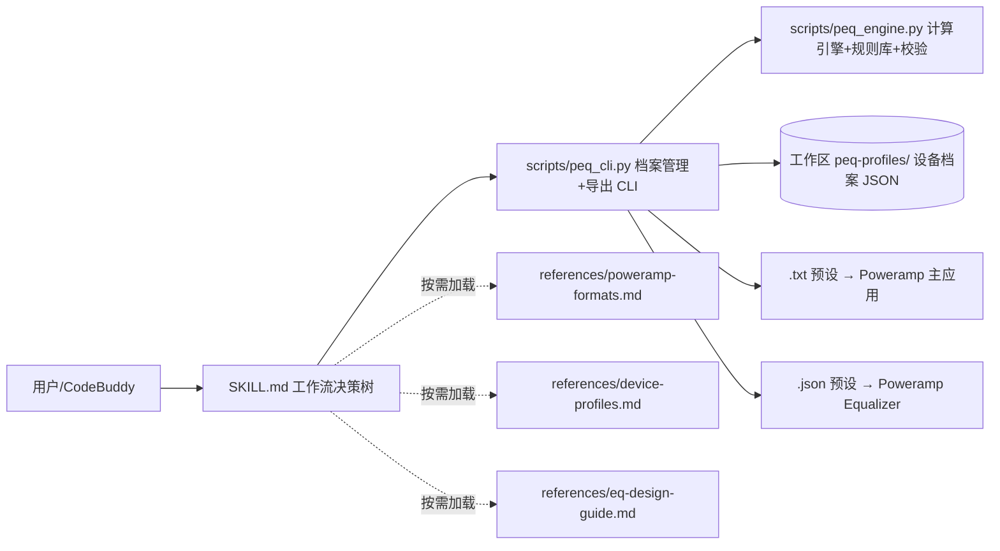

## 产品概述
构建一个名为 `poweramp-peq-tuner` 的技能模块（填充现有空骨架目录 `C:\Users\izual\.codebuddy\skills\poweramp-peq-tuner\`），使 CodeBuddy 成为"Poweramp PEQ 调优专家"：根据音响设备类型、频响特性与用户听感偏好，自动设计声学合理的参数均衡器方案，并生成可直接导入 Poweramp 主应用与 Poweramp Equalizer 的官方兼容预设文件，同时支持多设备配置档案管理与一键导出。

## 核心功能
- **设备声学规则库**：覆盖入耳式 IEM（动圈/动铁/混合）、耳塞、封闭式/开放式头戴耳机、蓝牙耳机、桌面/书架音箱、监听音箱、车载系统等常见设备类型，建立"设备类型 → 典型频响偏差特征 → 修正滤波器建议"的映射规则，并附基准目标曲线（Harman 2019 / IEF Neutral 简化版）。
- **PEQ 自动计算**：根据用户选择的设备类型与听感偏好（低频增强、人声突出、高音通透、均衡、减刺耳等），确定性计算滤波器参数（类型/频率/增益/Q 值），自动补偿 preamp 防止数字削波，并执行声学合理性校验（增益 ±10 dB、peak Q 0.4–5、shelf Q 0.5–0.9、频率 20–20000 Hz、常规 5–10 段）。
- **双格式导出**：一键导出两种官方兼容预设——`.txt`（REW/EqualizerAPO 参数格式，供 Poweramp 主应用 Equalizer → Presets → Import，支持最多 128 段）与 `.json`（Poweramp Equalizer 预设格式：JSON 数组包裹 `{name, preamp, parametric, bands[{type, channels, frequency, q, gain, color}]}`，type 0=低架/1=高架/3=峰值）。
- **多设备配置档案管理**：在当前工作区 `peq-profiles/` 目录中按设备保存 JSON 档案（设备类型、品牌型号、偏好、已计算 bands），支持创建、查看、编辑、删除、切换激活设备，跨会话持续可用。
- **技能化封装**：以中文 SKILL.md（含触发场景的 frontmatter description、工作流决策树、任务指引）+ 参考文档 + 可执行脚本 + 模板资产的形式交付，最终经 skill-creator 打包脚本验证并输出可分发的 zip。


## 技术栈
- 技能框架：CodeBuddy Skill（SKILL.md + scripts/ + references/ + assets/ 结构，用户级技能目录）
- 脚本语言：Python 3（标准库 `argparse`/`json`/`pathlib`，无第三方依赖，确保 Windows/PowerShell 环境零安装可用）
- 配置存储：JSON（设备档案、规则库、预设导出）

## 实现方案
在现有骨架 `C:\Users\izual\.codebuddy\skills\poweramp-peq-tuner\` 上原地构建，不新建项目。核心决策：

1. **确定性计算引擎而非 LLM 推导**：`peq_engine.py` 将"设备修正曲线 + 偏好目标曲线"合成为目标频响，再按声学经验规则选择滤波器类型（低频/高频用 shelf，中频驻点用 peak）、计算 Q 与增益。每次运行结果一致、可审计，避免模型每次重新发明公式导致参数漂移。
2. **双格式导出严格对齐已验证的官方规范**（研究中已从社区工具源码核实）：
   - Poweramp 主应用 `.txt`：`Preamp: -x.x dB` + `Filter N: ON PK|LSC|HSC Fc N Hz Gain N dB Q N`；
   - Poweramp Equalizer `.json`：`[{"name":…, "preamp":…, "parametric": true, "bands":[{"type":0|1|3, "channels":0, "frequency":int, "q":float, "gain":float, "color":0}]}]`，频率取整、缩进用制表符。
3. **档案存工作区、规则库存技能内**：设备档案是用户数据（随项目走），规则库是领域知识（随技能走），职责分离（SoC）。规则库以结构化 Python 数据定义，字段清晰便于用户自行扩展自定义设备类型。
4. **声学安全约束内置于导出前校验**：preamp 自动取 `min(0, -max_positive_gain)` 防削波；增益/Q/频率超界即报错或钳制并警告；打印合理性摘要供人工复核。

## 架构设计

- 分层：SKILL.md（流程编排，保持精简）→ references（领域知识，按需加载）→ scripts（确定性执行）→ 工作区 peq-profiles/（用户数据）。
- 数据流：设备类型+偏好 → 引擎合成目标曲线 → 滤波器参数 → 校验 → 档案落盘 → 按目标格式渲染导出。

## 目录结构
```
C:\Users\izual\.codebuddy\skills\poweramp-peq-tuner\
├── SKILL.md                       # [重写] 中文技能主文档：frontmatter(name/description含触发场景)、Overview、工作流决策树、设备档案管理任务、PEQ 计算任务、导出任务（含两种格式导入操作步骤）、声学校验规则、资源索引
├── scripts\
│   ├── peq_engine.py              # [新建] 纯计算模块：设备类型→频响修正映射规则库（IEM/头戴/蓝牙/音箱/车载等）、偏好→目标曲线、滤波器合成（shelf/peak 选型、Q 与增益计算、preamp 自动补偿）、声学合理性校验（范围钳制+警告）
│   └── peq_cli.py                 # [新建] 命令行工具：list-devices / create-profile / show-profile / list-profiles / edit-profile / delete-profile / set-active / export(--target poweramp|equalizer|both)；档案存工作区 peq-profiles/；导出渲染 .txt 与 .json 双格式
├── references\
│   ├── poweramp-formats.md        # [新建] 两种官方预设格式完整规范：字段表、type 映射（0=LS/1=HS/3=PK）、导入操作路径、兼容性坑（preamp 削波、JSON 数组包裹、频率取整、128 段上限）
│   ├── device-profiles.md         # [新建] 设备声学特征规则库文档：各类设备典型频响偏差、修正滤波器建议、基准目标曲线
│   └── eq-design-guide.md         # [新建] 听感偏好→滤波器设计原则：Q 与增益经验值、shelf/peak 选型、多滤波器叠加交互、preamp 计算法则
└── assets\
    ├── profile-template.json      # [新建] 设备档案 JSON 模板（schema 示例：name/device_type/brand/model/preference/bands/created_at/active）
    └── example-exports\
        ├── example-poweramp.txt   # [新建] 合法 .txt 导出示例，作为格式基准
        └── example-equalizer.json # [新建] 合法 .json 导出示例，作为格式基准
```

## 关键代码结构
```python
# peq_engine.py 核心数据契约
class Band(TypedDict):
    type: int        # 0=低架 1=高架 3=峰值
    frequency: int   # Hz, 20-20000
    q: float         # peak: 0.4-5.0, shelf: 0.5-0.9
    gain: float      # dB, -10.0 ~ +10.0

def compute_peq(device_type: str, preference: str, intensity: float = 1.0,
                user_bands: list | None = None) -> dict:
    """返回 {name, preamp, parametric: True, bands: list[Band]}，
    preamp = min(0, -max_positive_gain) 防削波。"""

def validate_preset(preset: dict) -> list[str]:
    """声学校验，返回警告列表（超界钳制提示、叠加增益过高等）。"""
```


## Agent Extensions
### Skill
- **skill-creator**
  - Purpose：指导本技能的创建全流程（结构规划、SKILL.md 编写规范、资源组织），并在完成时通过其 `package_skill.py` 脚本验证技能（frontmatter/目录/命名/描述质量）并打包为 `poweramp-peq-tuner.zip`
  - Expected outcome：产出通过官方校验、可直接分发安装的完整技能包；SKILL.md 符合祈使句写作与渐进式披露规范（精简主文档 + references 按需加载）
