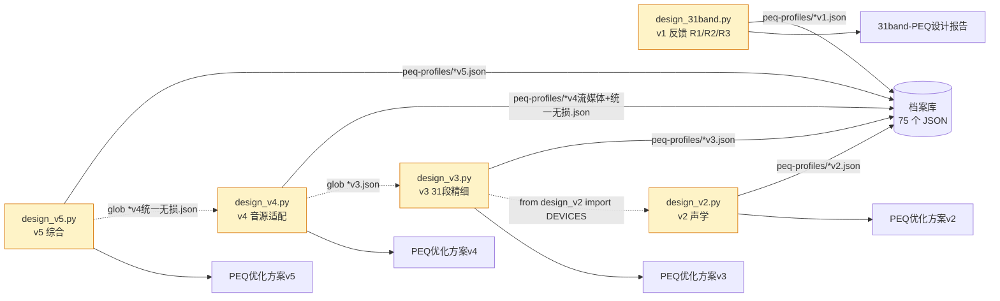
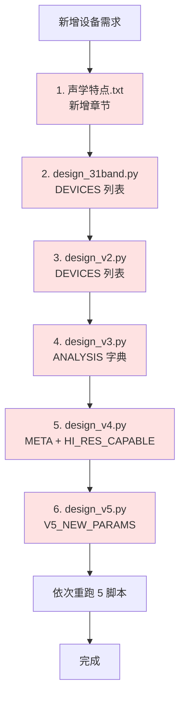

## 任务目标

对 `c:\Users\izual\Desktop\Poweramp\` 的 Poweramp PEQ 项目做系统性代码分析，按用户偏好（**可维护性 > 可扩展性 > 可读性 > 工程实践 > 性能**）输出 P0/P1/P2/P3 优先级排序的优化建议，每项含预期收益与实施要点。

## 项目现状（事实摘要）

| 指标 | 当前值 |
|---|---|
| 脚本总数 | 5 个 `design_*.py`（v1 反馈 / v2 声学 / v3 精细 / v4 音源 / v5 综合）|
| 代码总行数 | 2166 行（v1 349 / v2 458 / v3 261 / v4 532 / v5 566）|
| 设备 × 版本矩阵 | 12 设备 × 5 版本 = 60 主档案 + 15 衍生 |
| 报告 | 5 份 PEQ 优化方案（21-32KB markdown）|
| 声学参考 | 声学特点.txt v1.0（5 品类 × 12 设备 × 8 维度）|
| 测试 / lint / CI | 0 0 0 |

## 关键发现（按 5 维度）

### 维度 1：可维护性（最高优先）

| 问题 | 位置 | 影响 |
|---|---|---|
| 死代码 | `design_v4.py` L280-294 `apply_local()`（v4 本地音源已废）| 误导维护者，搜索噪声 |
| 共享常量重复 | 5 脚本均硬编码 `FREQS` / `GRID_Q` / `PROFILE_DIR` / `EXPORT_DIR` | 路径漂移风险 |
| 元数据分散 | v1 DEVICES / v2 DEVICES / v3 ANALYSIS / v4 META+HI_RES_CAPABLE / v5 V5_NEW_PARAMS 共 6 个字典 | 新增设备 6 处编辑 |
| Legacy 档案 | `peq-profiles/IEM低频增强.json` / `Rock-库.json` / `车载人声.json`（3 个非项目档案）| 目录污染 |
| 报告模板分散 | 5 脚本 main() 各实现 ~200 行 markdown 生成 | 风格漂移、修改 5 处 |

### 维度 2：可扩展性

| 问题 | 位置 | 改进方向 |
|---|---|---|
| 新增设备 6 处编辑 | 跨 5 脚本 + 声学特点.txt | 集中到 `devices.py` |
| `apply_*` 三函数 95% 重复 | `design_v4.py` L262-294 | 规则驱动重构（`@dataclass Rule`）|
| 报告生成无模板 | 5 脚本 main() 各自实现 | `report_templates.py` 共享 |
| 无 Onboarding 流程 | 新增设备无标准 SOP | README.md + 校验脚本 |

### 维度 3：可读性

| 问题 | 位置 |
|---|---|
| type hints 缺失 | design_v1 / v2 / v3 / v4 部分函数 |
| 5 脚本 main() 均 100-200 行 | 单函数复杂度高 |
| magic number / string | 多处硬编码（如 `12500 <= f <= 20000`）|

### 维度 4：工程实践

| 问题 | 现状 |
|---|---|
| .gitignore | 缺失；29MB `settings/Poweramp自带默认配置.json` 在仓库 |
| 单元测试 | 0 个 |
| Lint / formatter | 未配置（无 ruff / black / mypy）|
| CI | 无 |
| README / ARCHITECTURE | 缺失 |

### 维度 5：性能（最低优先）

- 5 脚本各 < 1s 运行 → **当前无瓶颈**
- 29MB settings/ 全量加载 → 仅在 CLI 启动慢时再优化
- 报告字符串拼接 O(n) → 可接受

## 优先级总览（7 项优化）

| 优先级 | 项 | 类别 | 核心收益 |
|---|---|---|---|
| **P0** | 死代码 + legacy 清理 | 可维护性 | 误导消除、目录 -3 文件 |
| **P0** | 设备元数据 + 共享常量集中 | 可维护性 / 可扩展性 | 新增设备 6 处→1 处 |
| **P0** | .gitignore | 工程实践 | 仓库 -29MB |
| **P1** | 规则驱动 + 报告模板重构 | 可读性 / 可扩展性 | 设计_v4/v5 代码 -40% |
| **P1** | 单元测试 + type hints | 可读性 / 工程实践 | 重构回归保护 |
| **P2** | README + ARCHITECTURE + 档案校验 | 工程实践 / 可维护性 | 上手时间 -70% |
| **P3** | CI/lint + settings/ 按需加载 | 工程实践 / 性能 | 长期质量保障 |

## 当前架构与痛点

### 5 版本依赖链

### 新增设备当前流程（6 处编辑痛点）

**P0 优化后**：6 处编辑 → 1 处（仅 `devices.py` 1 个新条目 + 1 脚本重跑）

## 关键约束与风险

- **不破坏现有输出**：v1-v5 5 份报告 + 60 主档案格式不变（向后兼容 Poweramp 导入）
- **不删除 v3 之前的脚本**：保留线性版本链（v3→v4→v5），仅做内部重构
- **声学依据不可改**：所有 `why` / `basis` 字段保持原文（来自声学特点.txt）
- **优先用现有技能工具**：`peq_engine` 已有 6 type / `validate_preset` 等可复用

# Agent Extensions
本次为代码分析 + 优化建议任务，已通过文件读取、目录列表、grep 模式搜索完成轻量级探索（已读取 design_v3.py / design_v4.py / design_31band.py / peq_engine.py 等关键文件，确认 2166 行代码量、5 脚本结构、12 设备清单、v3→v4→v5 依赖链）。当前上下文充足，可直接生成完整方案。

**未使用扩展**：
- `code-explorer`（subagent）—— 用于更深度的跨文件依赖追踪；当前分析粒度已足够，无需调用
- `lsp-code-analysis`（skill）—— 用于语义级重构预览；本次为规划任务，无需 LSP 实时重构

**若进入实施阶段**，以下场景建议使用扩展：
- 实施 P0 `devices.py` 集中化时 → `code-explorer` 扫描 5 脚本中所有 12 设备名出现位置（精确去重）
- 实施 P1 规则驱动重构时 → `lsp-code-analysis` 预览 v4 apply_* 重构影响面
